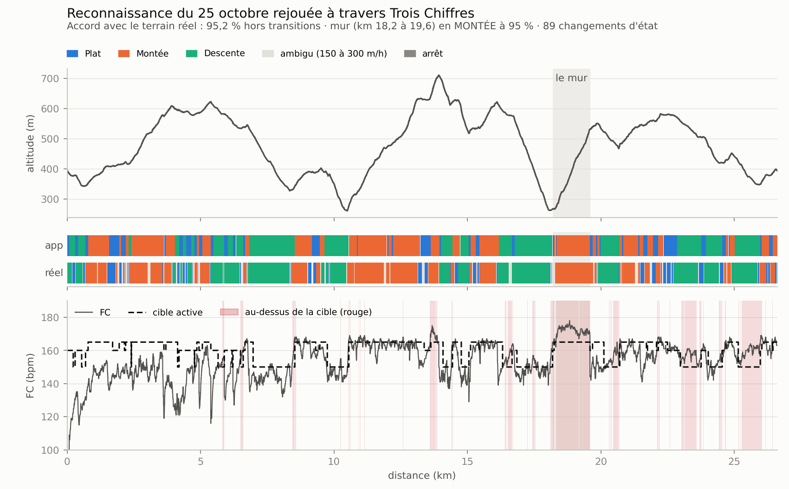

# Trois Chiffres — app SuuntoPlus pour Suunto Vertical

**L'app affiche en permanence la cible de FC du terrain sous tes pieds — montée, plat ou descente —, détecté par le baromètre, et te prévient si tu la dépasses trop longtemps.** C'est la mise en œuvre de la spec « Trois Chiffres » du 5 novembre 2026, construite sur l'API SuuntoPlus réelle (référence de SuuntoPlus Editor 1.45) et testée en rejouant ta reconnaissance du 25 octobre.



*Le ruban « app » est le terrain détecté par l'app, seconde par seconde. Le ruban « réel » est le terrain calculé après coup sur l'altitude. En bas : ta FC, la cible active et les secondes passées au rouge (réglages par défaut, plan A).*

## Contenu du dépôt

| Chemin | Rôle |
| --- | --- |
| `TroisChiffres/` | **L'app SuuntoPlus** : le dossier à ouvrir dans VS Code et à envoyer sur la montre |
| `TroisChiffres/main.js` | Toute la logique : détection du terrain, cibles, couleurs, alertes, statistiques |
| `TroisChiffres/t.html`, `b.html`, `ca.html`, `cb.html` | Écran principal, bilan, confirmations « Passer en plan A/B ? » |
| `TroisChiffres/manifest.json`, `data.json` | Déclaration de l'app, et réglages utilisés au moment de l'envoi |
| `configurations/` | Les trois jeux de réglages de la spec : course (Pichauris), sortie longue, footing |
| `test/` | 96 tests automatiques, dont le rejeu complet de ta sortie du 25 octobre |
| `test/fixtures/sortie-2026-10-25.json.gz` | Ta sortie allégée : FC, vitesse verticale, vitesse, distance et altitude, **sans GPS ni numéro de série** |
| `outils/rejouer.js` | Rejoue n'importe quelle sortie à travers l'app et produit un bilan, plus un CSV en option |
| `outils/analyser-export.js` | Analyse un export de la montre fait avec l'app : FC par terrain, bascules datées |
| `outils/figure_rejeu.py`, `outils/alleger.js` | La figure ci-dessus, et l'allègement d'un export pour les tests |

## Installer l'app sur ta Suunto Vertical

Ta montre est une Suunto Vertical de première génération (nom de code « Rostock », écran « o » de 280 × 280 px), d'après ton fichier du 25 octobre. L'app vise cet écran et fonctionne aussi sur les écrans UI2 « n » et « q » (Vertical 2, Race…).

### Ce qu'il te faut

- Un ordinateur **Windows 10 ou plus (64 bits) ou macOS** : SuuntoPlus Editor ne tourne pas sous Linux.
- **Visual Studio Code**, avec l'extension **SuuntoPlus Editor** de Suunto. Dans VS Code, `Ctrl+P` (`Cmd+P` sur Mac) puis :

  ```text
  ext install Suunto.suuntoplus-editor
  ```

- Le **câble USB** de la montre.
- **SuuntoLink fermé**, avec l'option « Démarrer SuuntoLink automatiquement » désactivée : il entre en conflit avec l'éditeur.

### Étapes

1. Clone ce dépôt sur l'ordinateur, puis ouvre-le dans VS Code (`Fichier > Ouvrir le dossier`).
2. Choisis les réglages : copie le fichier de `configurations/` qui convient par-dessus `TroisChiffres/data.json`, ou modifie ce dernier directement (voir [Réglages](#réglages)).
3. Branche la montre en USB. Elle apparaît sous **Suunto Watch** dans la vue Explorateur de VS Code.
4. Dans la vue **SuuntoPlus Apps**, sur « Trois Chiffres », lance **Build and Add Sports App to Watch**. Tu peux aussi passer par la palette de commandes (`Ctrl+Shift+P`) : `SuuntoPlus: Deploy to Watch`.
5. Le build vérifie l'app. S'il signale une erreur, envoie-moi le texte de la vue *Output > SuuntoPlus* (voir [Limites](#limites-et-ce-qui-reste-à-faire)).
6. Sur la montre, dans la vue de départ de ton mode sport, ouvre le choix **SuuntoPlus** et sélectionne **Trois Chiffres**. Race Surgeon peut rester actif en parallèle.

### Attention à la synchronisation avec l'app Suunto

La documentation de SuuntoPlus Editor prévient : **l'app Suunto du téléphone peut supprimer une app installée depuis l'éditeur lors d'une synchronisation**. En pratique :

- envoie l'app sur la montre **après** la dernière synchronisation avant ta sortie, et vérifie qu'elle figure bien dans la liste SuuntoPlus avant le départ ;
- si elle a disparu après une synchronisation, renvoie-la depuis VS Code (étape 4) ;
- les **réglages** d'une app installée de cette façon sont ceux de `data.json` au moment de l'envoi. Les régler depuis l'app Suunto du téléphone, comme le prévoit la spec, suppose une app publiée dans le SuuntoPlus Store : programme Partenaire Suunto, puis soumission par l'API Zone (`SuuntoPlus: Create Source Package`). D'ici là, change `data.json` et renvoie l'app.

## En course : écrans et boutons

**Écran principal** — un seul écran compte :

| Position | Contenu |
| --- | --- |
| Haut | Terrain et cible : icône montée, plat ou descente suivie de la cible (« ≤ 150 » en descente), ou ARRÊT, LIBRE. Les alertes s'y affichent 6 s : FC HAUTE, PLAFOND, BOIRE, CAPTEUR FC, PLAN A/B. |
| Centre, en très grand | FC en direct : gris sous la bande, vert, orange, rouge ; blanche en ARRÊT et en zone libre ; « -- » sans signal |
| Droite | Plan actif, A ou B |
| Bas gauche | FC moyenne depuis le départ (arrêts compris, comme le champ natif) |
| Bas droite | En montée : VAM de la montée en cours. Ailleurs : allure lissée sur 30 s. À l'arrêt : « -- ». |

Les montres Suunto n'ont pas les glyphes ▲ ▬ ▼ ■ dans leurs polices : l'app utilise à leur place les icônes de la police Suunto.

**Bouton bas** (sur l'écran de l'app) :

- **appui court** : écran **bilan** (FC moyenne et temps par terrain, VAM moyenne, temps au rouge) ; retour par le bouton bas, un toucher, ou tout seul après 30 s ;
- **appui long (2 s)** : « **Passer en plan B ?** » (ou A), avec les cibles et le plafond de l'autre plan. **Appui court sur le bouton bas = oui** ; bouton haut ou central = non ; sans réponse, annulation au bout de 10 s.

Les boutons haut (pause) et central (changement d'écran) gardent leur rôle natif. Si tu verrouilles les boutons, ces gestes sont bloqués aussi. Le tour manuel ne se fait plus depuis l'écran de l'app : fais-le depuis un écran natif (ton tour automatique au kilomètre continue).

**Vibrations** : FC haute = 2 courtes, plafond = 3 longues, boire = 1 longue, capteur = 1 longue. La montre ne propose pas de motifs de vibration libres : l'app joue une indication par seconde (`Info` pour une courte, `Interval` pour une longue), et la montre vibre si les vibrations sont activées dans ses réglages.

## Réglages

| Réglage | Défaut | Rôle |
| --- | --- | --- |
| `cibles_A` | `160 165 150` | Cibles plat, montée, descente du plan A |
| `cibles_B` | `155 160 150` | Idem, plan B |
| `plafond_A` | `167` | Plafond absolu du plan A, tous terrains |
| `plafond_B` | `165` | Plafond absolu du plan B |
| `plan_initial` | `0` | Plan actif au départ : `0` = A, `1` = B |
| `zones` | vide | Ajustements par distance (voir ci-dessous) |
| `marge` | `3` | Battements au-dessus de la cible avant le rouge |
| `seuils_vz` | `300 150` | Seuils d'entrée et de sortie, en m/h |
| `persistance` | `20` | Secondes au-delà du seuil avant de changer d'état |
| `delai_alerte` | `45` | Secondes en rouge avant de vibrer |
| `grace` | `10` | Minutes sans alerte FC au départ |
| `boire` | `15` | Minutes entre deux rappels, `0` pour désactiver |

Dans `data.json`, toutes les valeurs s'écrivent **entre guillemets** : la montre les stocke en texte. Une valeur illisible est remplacée par sa valeur par défaut.

### Zones par distance

Des tranches séparées par `;`, chacune `début-fin` en km suivie de jetons : `-4` / `+2` décale les trois cibles du plan actif ; `p155`, `m163`, `d148` fixent la cible plat, montée ou descente ; `a165` fixe le plafond ; `libre` supprime couleurs et alertes FC mais garde les statistiques.

Exemple de Pichauris : `0-11.6 -4; 40.2-42.0 m163 a165; 44.7-99 libre`.

Quand des tranches se chevauchent, **elles s'appliquent dans l'ordre où elles sont écrites** : un décalage s'ajoute, une valeur fixée remplace. La dernière tranche l'emporte donc en cas de conflit. Par grand froid, ajoute `0-99 -3` **en tête** : il s'ajoute au −4 du départ (−7), et le `m163` du mur, écrit après, reste à 163. Écrit en fin de liste, le −3 s'appliquerait aussi au mur (160). La virgule décimale (`11,6`) et le signe « − » sont acceptés.

La distance GPS dérive de quelques pour cent en trail : **élargis chaque tranche d'un à deux hectomètres**.

### Configurations types

| Fichier | Usage |
| --- | --- |
| `configurations/course-pichauris.json` | Plans A et B de Pichauris, zones du parcours |
| `configurations/sortie-longue.json` | Plan B à `152 155 148`, plafond 158 |
| `configurations/footing.json` | Plan B à `150 155 148`, plafond 160, sans rappel boire |

Ces cibles valent autour de 15 °C.

## Tester sans la montre

### Tests automatiques

Avec Node.js 22 ou plus récent :

```bash
npm install
```

```bash
npm test
```

Les **96 tests** couvrent :

- la table de couleurs de Pichauris, plans A et B, sur les trois terrains ;
- la machine à états : latence de 25 à 30 s, hystérésis, col et creux sans plat, bosses de moins de 20 s, sauts d'altitude, arrêt photo, bouchon, perte du GPS, pause de la montre ;
- les alertes : grâce, rappels toutes les 3 min, plafond en 15 s, boire, capteur, silences, pics de FC ;
- les zones par distance, la bascule de plan en deux gestes, le bilan et le résumé de fin ;
- les règles du validateur officiel (ESLint en ES5, déclarations de fonctions, limites du manifeste, structure des écrans).

Le code est aussi exécuté **dans la forme que lui donne le minifieur Suunto** avant l'envoi sur la montre (entrées et sorties dans un tableau, fonctions de rappel fusionnées). Le rejeu complet du 25 octobre donne exactement le même résultat, seconde par seconde, que le code source.

### Résultats sur ta reconnaissance du 25 octobre

Ce sont les points 1 à 4 du plan de test de la spec, sur 4h16 de séance (hors pauses), 26,6 km et 1 516 m D+ :

| Point de la spec | Attendu | Obtenu |
| --- | --- | --- |
| 1. Le mur en MONTÉE, km 18,2 à 19,6 | MONTÉE | **95 %** du temps ; 100 % du corps du mur (km 18,4 à 19,55) |
| 1. La descente à −24 % qui le précède | DESCENTE | **100 %** (km 16,9 à 18,1) |
| 2. Accord avec la pente réelle, hors transitions | > 90 % | **95,2 %** sur 9 694 s mesurées |
| 3. Changements d'état sur 4h23 | quelques dizaines, pas des centaines | **89**. Le profil lui-même, lissé après coup, en compte 62 : le parcours est très vallonné |
| 4. Silence des alertes FC les 10 premières minutes et à chaque arrêt | aucune alerte | **aucune** ; seul le rappel boire vibre à 15 min |

Au pied du mur, une petite bosse d'environ 25 s à +430 à +500 m/h (vers le km 18,2), suivie d'un replat, passe brièvement en MONTÉE (km 18,25 à 18,29) : c'est la règle des 20 s de persistance qui joue, comme prévu.

Avec les réglages par défaut (plan A), l'app aurait donné : plat 150 bpm pendant 41 min, montée 160 bpm pendant 2h07 (VAM moyenne de 586 m/h), descente 148 bpm pendant 1h28, et 47 min au rouge. Avec la configuration de course de Pichauris, elle aurait déclenché 34 alertes FC, dont une alerte plafond toutes les 2 min pendant tout le mur (FC de 169 à 178 pour un plafond de 167).

### Rejouer une autre sortie

Pour la sortie du 18 octobre, plus dense en dénivelé (point 5 du plan de test), exporte-la en JSON puis :

```bash
node outils/rejouer.js sortie-18-octobre.json --reglages configurations/course-pichauris.json --csv rejeu.csv
```

L'outil affiche le temps et la FC par état, l'accord avec le profil réel, les changements d'état, chaque alerte (heure et km) et le résumé de fin. `--simulateur` ignore les pauses, comme le simulateur Suunto. Pour la figure (Python avec matplotlib) :

```bash
python3 outils/figure_rejeu.py rejeu.csv figure.png --zone "18.2-19.6:le mur"
```

### Au simulateur SuuntoPlus

Dans VS Code, vue SuuntoPlus Apps, ouvre l'app dans le **simulateur SuuntoPlus**, règle **Display** sur l'écran de la Vertical (« o »), puis charge un fichier de séance. Le simulateur accepte le **Suunto JSON** (ton export de 8 Mo, ou l'extrait décompressé de `test/fixtures/`) et le **FIT**. Il rejoue l'horloge réelle **sans tenir compte des pauses** de la montre. Il ne fait pas vibrer : les indications ne s'y entendent pas.

## Après la sortie : analyser l'export

La montre enregistre chaque seconde le terrain (0 plat, 1 montée, 2 descente, 3 arrêt), la cible active, la couleur (0 gris, 1 vert, 2 orange, 3 rouge, 4 neutre) et le plan (1 = A, 2 = B). Elle écrit aussi un résumé de fin, limité par Suunto à 8 valeurs :

- FC moyenne et temps par terrain (une ligne par terrain) ;
- VAM moyenne ;
- temps au-dessus des cibles ;
- nombre d'alertes FC ;
- bascules, avec les trois premières en clair (plan, km, heure).

Pour tout récupérer, y compris l'heure et le km de **chaque** bascule, exporte la séance en JSON depuis VS Code (vue Suunto Watch, workouts) puis :

```bash
node outils/analyser-export.js export.json
```

## Les points « à vérifier dans la documentation SuuntoPlus »

| Point de la spec | Réponse (référence SuuntoPlus Editor 1.45 et code du simulateur) |
| --- | --- |
| Nom des ressources FC et vitesse verticale, fréquence | `Activity/Move/-1/HeartRate/Current` (en Hz) et `Activity/Move/-1/VerticalSpeed/Current` (en m/s). Dans le simulateur, les fenêtres Lap et Activity ne donnent pas de valeur « Current » pour la FC : il faut la fenêtre Move. `evaluate()` est appelé toutes les secondes (±5 ms), y compris en pause et avant le départ. |
| API de vibration, motifs | `playIndication(nom)` avec six indications : `Button`, `Confirm`, `Info`, `Interval`, `StartTimer`, `StopTimer`. Elle vibre si les vibrations sont activées sur la montre. Pas de motif libre : les « 2 courtes » et « 3 longues » sont jouées à une seconde d'intervalle. |
| Boutons en séance, confirmation | `<pushButton>` avec `onClick`, `onLongPress` (2 s par défaut, au moins 0,6 s), `type`/`longType` pour le verrouillage. Les écrans changent par `unload('_cm')` et `getUserInterface()`. La confirmation reprend le composant officiel `<:dialog>`. |
| Type et longueur des réglages texte | Types `int`, `float`, `string`, `boolean`, `enum` ; un texte a un `maxLength` en octets (UTF-8), sans plafond documenté. Toutes les valeurs sont stockées en texte (`localStorage.getItem`). |
| Format de fichier du simulateur | Suunto JSON (DeviceLog) et FIT, plus GPX dans le code. Rejeu sur l'horloge réelle, pauses ignorées. |
| Sorties de l'app dans l'export | Oui en JSON : échantillons `ZappSample` (canal, valeur, écrits à chaque changement), canaux et résumé dans l'en-tête `Zapps`. 5 sorties enregistrées au plus, 8 valeurs de résumé au plus (la doc prévient qu'en pratique on bute parfois vers 4 ou 5). Leur présence dans le FIT exporté par l'app Suunto n'a pas été vérifiée. |
| Limites de mémoire | Aucun chiffre publié. La doc recommande les tableaux typés et signale les dépassements dans les événements système (`Zapp: ReleaseMem -> None avail.`). L'app tient tous ses tampons (15 s de vitesse verticale, 30 s de vitesse, 5 s de FC, 12 tranches de zones) dans un seul `Float32Array` de 151 valeurs. |

## Choix d'interprétation et écarts à la spec

- **Bouton bas** : la spec dit « un bouton ». C'est le bas : l'appui long lance la bascule, l'appui court ouvre le bilan, au prix du tour manuel sur cet écran. Ta sortie du 25 octobre ne contient aucun tour manuel, et la pause comme le changement d'écran restent intacts.
- **Traîne** : pendant 60 s après un changement de terrain, la couleur se juge avec la plus haute des cibles en jeu, même si deux changements s'enchaînent (haut de col : montée, plat, descente). La cible affichée en haut est cette cible active, celle qui fixe la couleur.
- **Alertes** : au-dessus du plafond, l'alerte plafond (15 s) remplace l'alerte FC haute, puis la FC haute ne revient pas avant 3 min. La durée de grâce, l'ARRÊT, la zone libre et la minute qui suit une bascule remettent les compteurs à zéro : il faut 45 s de rouge *après* pour vibrer. Le compteur « Alertes FC » ne compte que FC haute et plafond, pas les rappels boire ni capteur.
- **Arrêt** : on revient à l'état d'avant au bout de 5 s au-dessus de 2 km/h, sans traîne ni remise à zéro de la VAM de la montée en cours. Le pseudo-code de la spec continuait d'évaluer le terrain dans la seconde même où l'ARRÊT commence ; l'app s'arrête là.
- **Pic de FC** : une valeur à plus de 20 bpm de la médiane des 5 valeurs précédentes est rejetée (l'affichage garde la dernière bonne valeur). Une vraie hausse durable passe au bout de 3 s.
- **D+ et VAM** : le D+ cumule la vitesse verticale positive seconde par seconde en MONTÉE. C'est l'équivalent des gains d'altitude barométrique, sans entrée supplémentaire.
- **Résumé de fin** : 7 valeurs au lieu de la liste complète, à cause de la limite de 8 ; le reste se lit dans les canaux enregistrés.
- **Montres UI1** (Suunto 3, 5, 9 Baro) : non visées, Suunto ne maintient plus SuuntoPlus sur ces écrans.

## Limites et ce qui reste à faire

- **Build officiel non exécuté** : l'environnement où l'app a été écrite a bloqué l'outil de build du VSIX Suunto. Toutes ses règles documentées ont été reproduites dans les tests, mais **le premier build se fera chez toi** dans VS Code (étape 4). Les points les plus susceptibles d'y coincer : la classe `f-d-xxxl` (FC géante, réservée aux écrans UI2 par un bloc `<:if test="{{ IS_UI2 }}">`) et les formules `script x => …` des `<eval>`.
- **À vérifier sur la montre** :
  - la sensation des vibrations `Info` et `Interval` (modifiables en tête de `main.js` : `VIB_COURTE`, `VIB_LONGUE`) ;
  - la lisibilité des couleurs au soleil ;
  - le comportement de la ressource FC quand le capteur décroche : si la montre garde la dernière valeur au lieu de la vider, l'alerte capteur ne peut pas se déclencher.
- **Plan de test sur le terrain** (points 6 à 8 de la spec) : une sortie longue avec l'app à côté de l'écran natif, une séance de côtes pour mesurer la latence réelle en pied de montée, une sortie avec Race Surgeon en parallèle.
- Et toujours : **pas pour Pichauris**.
